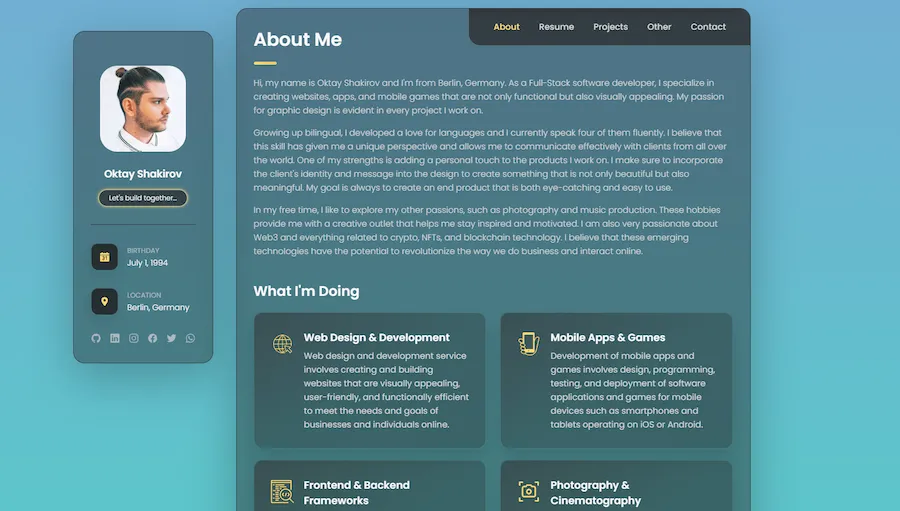

# Portfolio

My personal portfolio at [oktayshakirov.com](https://oktayshakirov.com). A fully responsive single-page site built with plain HTML, CSS and JavaScript modules. No framework and no build step: most content lives in JSON files and is rendered in the browser.

<p align="center">
  <a href="https://oktayshakirov.com">
    
  </a>
</p>

<p align="center">
  <a href="https://oktayshakirov.com"><strong>➥ Live Demo</strong></a>
</p>

## Features

- Tabs for About, Projects, Side Projects, Resume and Contact, each with a shareable link (for example [oktayshakirov.com/#resume](https://oktayshakirov.com/#resume))
- Projects, side projects, resume, certificates, skills and social links loaded from `data/*.json`
- Highlights that update themselves: years of experience, apps in the stores and live websites (counted from `projects.json`) and public GitHub repositories
- GitHub contribution calendar
- Project filter by category and a "Currently Building" card for work in progress
- Video call booking through Calendly in an in-page modal
- Animated starry background that pauses when the tab is hidden and respects "reduce motion"
- Self-hosted Poppins font, WebP images and native lazy loading
- Privacy policy pages for my mobile apps in `privacy-policy/`

## Running locally

The content is loaded with `fetch()`, so the site needs to be served over HTTP (opening `index.html` directly from disk won't load the data). Any static server works, for example:

```bash
npx http-server . -p 8123 -c-1
```

Then open [http://localhost:8123](http://localhost:8123). The VS Code Live Server extension works too.

## Project structure

```
index.html                   Page markup. The About tab is written here, the other tabs are rendered from data/
404.html                     Not found page
data/                        Content (see below)
assets/css/style.css         Layout and components
assets/css/starry-night.css  Starry background theme
assets/js/main.js            Entry point, starts all modules
assets/js/modules/           One module per feature (navigation, rendering, contact, analytics, ...)
assets/images/               Images (projects/, certificates/, icons)
assets/fonts/                Self-hosted Poppins
privacy-policy/              App privacy policies
sitemap.xml, robots.txt      Search engines
CNAME                        Custom domain for GitHub Pages
```

## Editing content

| File | What it controls |
| --- | --- |
| `data/projects.json` | Projects tab |
| `data/sideworks.json` | Side Projects tab |
| `data/experience.json` | Experience and education in the Resume tab |
| `data/certificates.json` | Certificates in the Resume tab |
| `data/technologies.json` | "Development Skills" icons on the About tab (`name`, `image`, `alt`) |
| `data/socials.json` | Social links in the sidebar and Contact tab (`icon` is an [Ionicons](https://ionic.io/ionicons) name) |

The intro text, highlights, languages, focus areas and strengths on the About tab are written directly in `index.html`.

### Projects

```json
{
  "title": "Drone Pal",
  "description": "One or two sentences about the project.",
  "category": ["applications"],
  "status": "Complete Build",
  "type": "Solo Project",
  "context": "School Project",
  "technologies": "React Native",
  "image": "./assets/images/projects/drone-pal.webp",
  "links": {
    "ios": "https://apps.apple.com/...",
    "android": "https://play.google.com/..."
  }
}
```

- `category`: any of `ai`, `websites`, `applications`, `games`, `designs` (these match the filter buttons in `loadFilters` in `assets/js/modules/data-loader.js`)
- `context` is optional and shown after `type`
- `links`: `preview`, `ios`, `android`, `github` and `figma` take a URL. Set `previewDisabled`, `iosDisabled` or `androidDisabled` to `true` for a greyed-out "coming soon" button, or `previewShutDown` to `true` for a project that is no longer online
- `"currentlyBuilding": true` shows the project in the "Currently Building" card at the top instead of the grid

### Side projects

Side projects have `title`, `categories` (a list of labels), `description`, `image`, `alt` and `links`. Supported links are `website`, `github`, `youtube`, `tiktok`, `instagram`, `spotify`, `googlePlay`, `adobeStock` and `shutterstock`. `github`, `youtube` and `tiktok` can also be a list of `{ "url": "...", "label": "..." }` to show several buttons.

### Resume

`experience.json` and `certificates.json` are lists of groups. Each group has a `group` title, an Ionicons `icon` and `items`:

- Experience: `title`, `organization` (optional), `period`, `description`
- Certificates: `title`, `issuer`, `image`

## Using this portfolio as a template

If you build your own portfolio from this code, update these places:

- **Google Analytics:** in `assets/js/modules/analytics.js`, replace `G-G1H2WJ7XH4` with your own tracking ID and update `AUTHORIZED_DOMAINS` with your domain(s). Analytics only runs on the listed domains, so copies of this site don't send traffic to my account.
- **GitHub:** the username in `assets/js/modules/highlights.js` (`GITHUB_USERNAME`, plus `CAREER_START_YEAR`) and in `assets/js/modules/github-calendar.js`
- **Calendly:** `CALENDLY_URL` in `assets/js/modules/contact.js`
- **SEO:** meta tags in `index.html`, structured data in `assets/js/modules/seo.js`, `sitemap.xml`, `robots.txt` and `CNAME`
- **Ads:** the AdSense meta tag in `index.html` and `app-ads.txt`

## Attribution

When this portfolio runs on any domain other than oktayshakirov.com, it shows a small "Made by Oktay Shakirov" credit in the sidebar. Please keep it visible. The credit is added back automatically if it's removed.

If you'd like to use this portfolio without the credit, get in touch:

- **Email:** info@oktayshakirov.com
- **LinkedIn:** [oktayshakirov](https://www.linkedin.com/in/oktayshakirov)

## License

MIT, see [LICENSE](./LICENSE).

*Translation: Of course you can use this for your project! Just make sure to say where you got this from :)*
